# Dispute Alpha

**A credit-dispute operations platform built entirely on Cloudflare.** Specialists onboard clients, import tri-bureau credit reports, see disputable items flagged automatically, draft and approve dispute letters, and track every bureau's response deadline. Clients follow their case in a secure portal. Personal data is encrypted, and every access is logged.

<p align="center">
  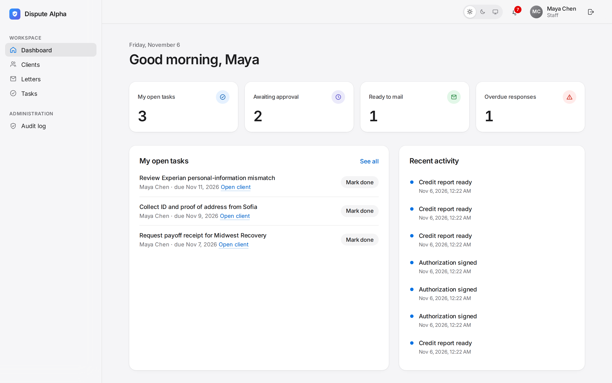
</p>

> All names, addresses, and credit data in these screenshots are fictional demo data.

## Contents

- [The product in screenshots](#the-product-in-screenshots)
- [What it does](#what-it-does)
- [How it is built](#how-it-is-built)
- [Security and privacy](#security-and-privacy)
- [Run it locally](#run-it-locally)
- [Tests and checks](#tests-and-checks)
- [Deploying](#deploying)
- [Project status](#project-status)
- [Documentation](#documentation)

## The product in screenshots

### Client experience

Clients join by invitation only, set up two-factor sign-in, and see their case in plain language.

| Sign in | Two-factor enrollment from an invite |
|---|---|
| 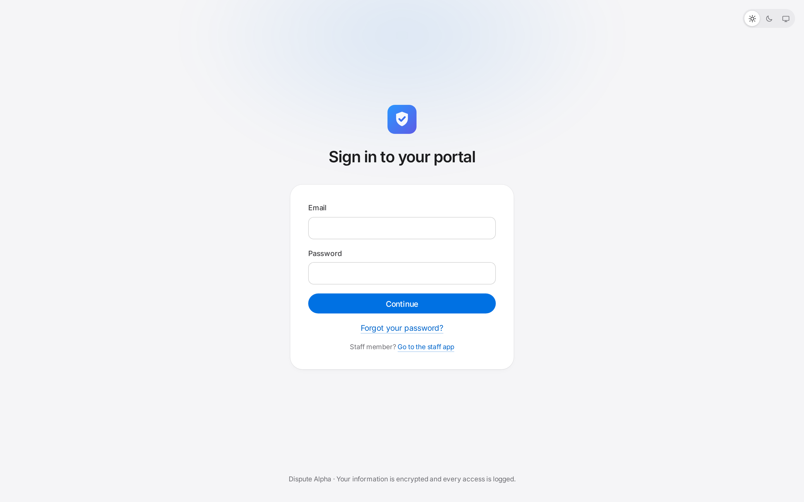 | 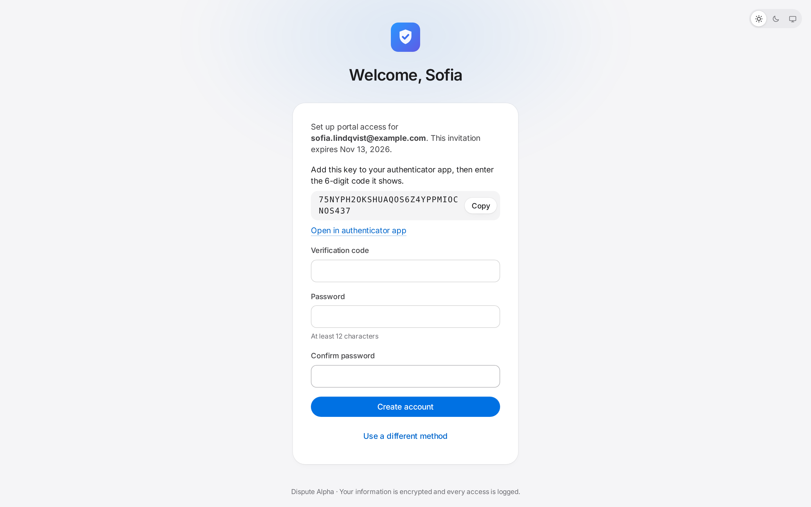 |

| Case overview | Credit report with reasons |
|---|---|
| 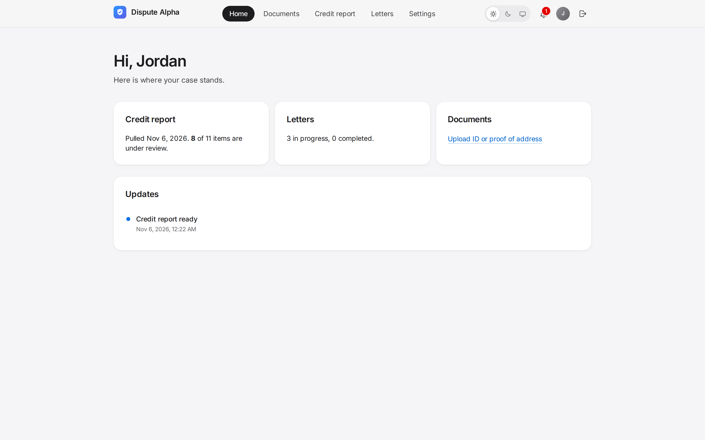 | 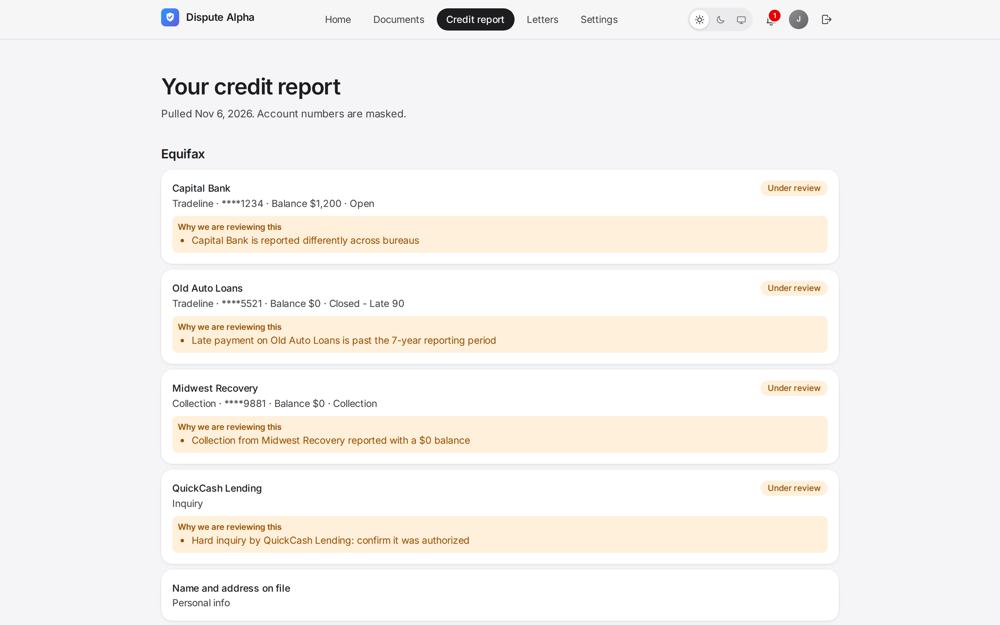 |

<p align="center">
  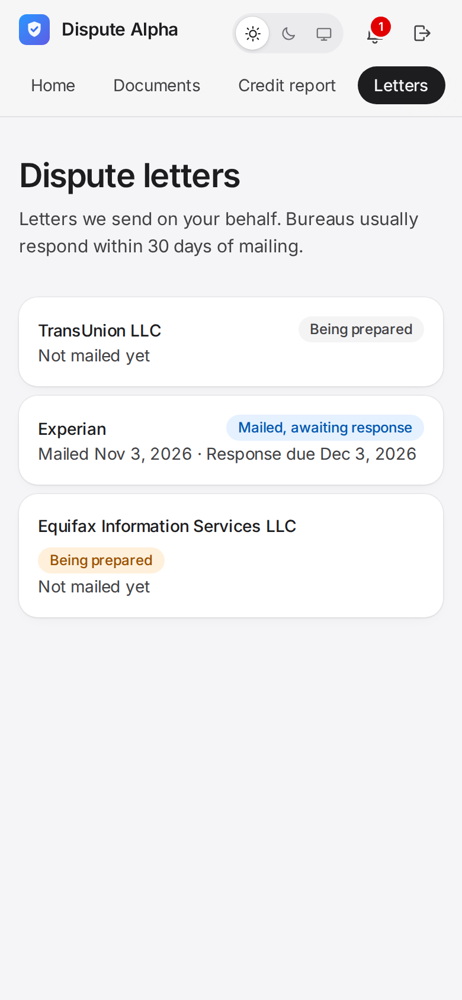<br>
  <sub>The portal works on phones, too.</sub>
</p>

### Staff workflow

| Clients | Credit report with automatic flags |
|---|---|
| 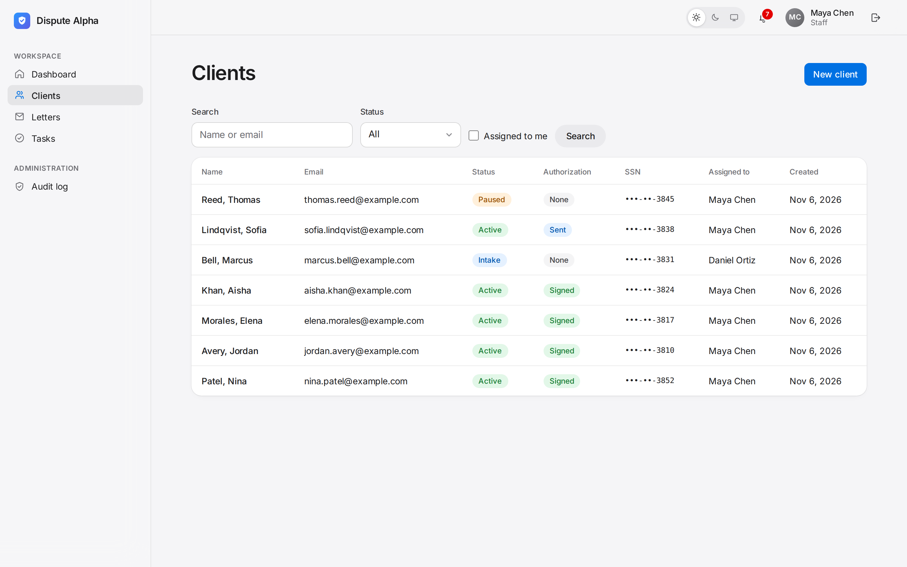 | 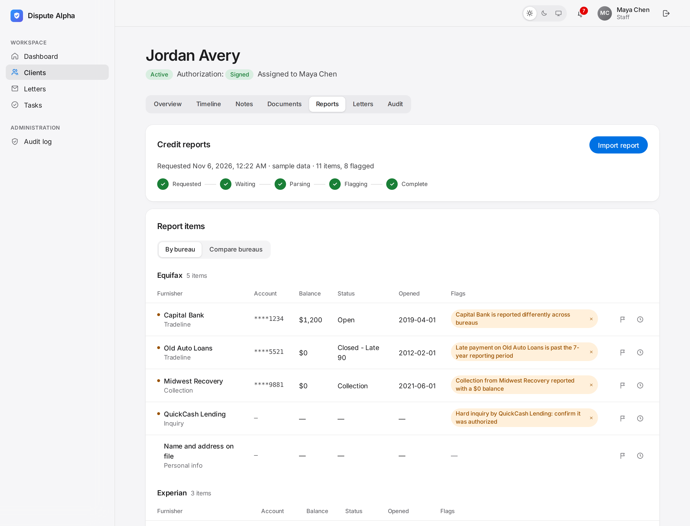 |

| Build a dispute round | Draft the letter |
|---|---|
| 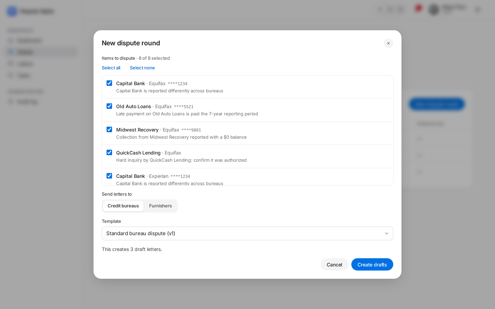 | 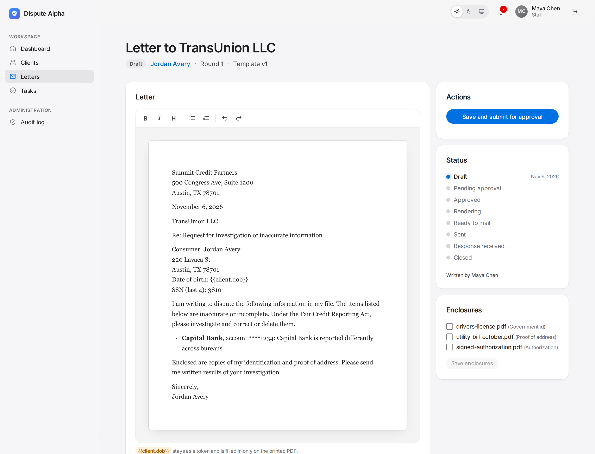 |

| Approval by a second person | Audit log |
|---|---|
| 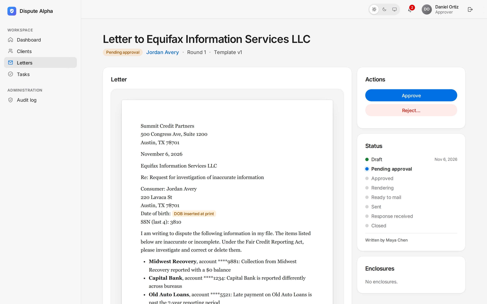 | 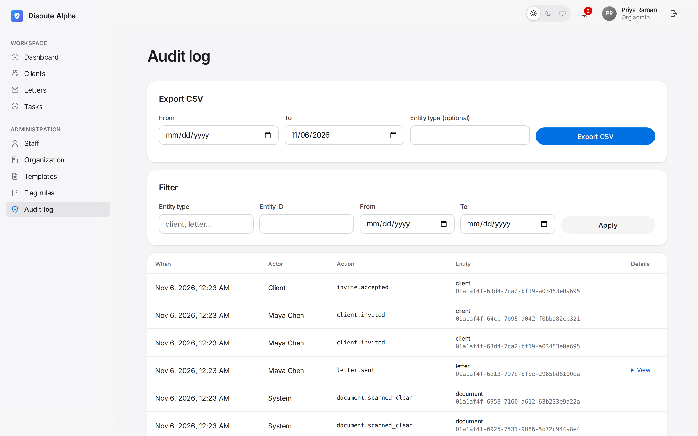 |

### Light and dark

Both apps have a Light, Dark, and Auto appearance switch. Light is the default.

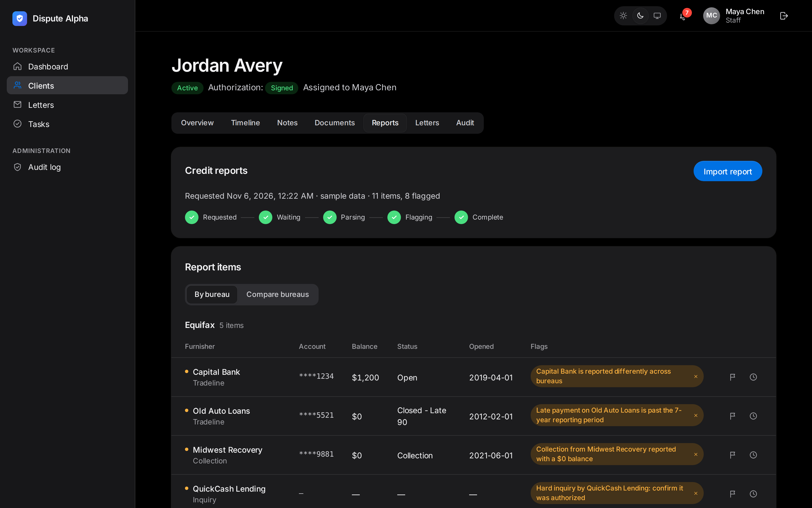

## What it does

**For clients**
- Invitation-only accounts with an authenticator app or emailed codes for two-factor sign-in.
- Upload ID and proof of address. Every file is virus-scanned before anyone can open it.
- See credit report items with masked account numbers and plain-language reasons, follow letter status, and get notifications.

**For specialists**
- Client records with SSN and date of birth encrypted. Revealing them is a separate, logged action.
- One-click import of a tri-bureau credit report, which runs in the background and survives provider delays.
- Automatic flagging from rules the organization edits itself: zero-balance collections, late payments past seven years, unconfirmed hard inquiries, accounts reported differently across bureaus, mismatched personal information, and obsolete public records.
- Dispute rounds that create one letter per bureau or creditor from versioned templates with merge fields.
- An edit lock, so two people never change the same client's letters at once.
- Second-person approval. Approval also requires the client's signed authorization, collected by e-signature.
- Print-ready PDFs with enclosures, response deadlines with reminders 7 and 3 days before, overdue tasks, and a daily digest.

**For administrators**
- Staff and roles, organization settings, letter templates, and flag rules.
- An append-only audit log with CSV export and a monthly archive.

## How it is built

```
Browser ──► Cloudflare edge: TLS, WAF, rate limits, Turnstile, Access (staff)
              │
              ▼
          da-app Worker ── React app (static assets) + Hono API at /api/v1
              │   D1 · R2 · Queues · Workflow bindings · ClientLock Durable Object
              ▼
          da-jobs Worker ── queue consumers · 3 Workflows · cron jobs
              │   Browser Run (PDFs) · ClamAV container · Email Service / Postmark · Twilio
              ▼
          Credit monitoring API · E-signature provider (Dropbox Sign)
```

| Layer | Choice |
|---|---|
| Frontend | React 19, Vite, TanStack Router and Query, Tailwind CSS 4, TipTap |
| API | Hono on Cloudflare Workers, Zod validation shared with the frontend |
| Data | Cloudflare D1 with Drizzle ORM; R2 for documents, raw reports, letters, and backups |
| Background work | Cloudflare Queues, Workflows (report import, letter pipeline, deadlines), Cron Triggers |
| Documents | Browser Run for PDFs, ClamAV in a Cloudflare Container for virus scanning |
| Identity | Cloudflare Access for staff; invite-only passwords (Argon2id) and TOTP or email codes for clients |
| Infrastructure | Terraform for the zone, firewall, Access, and storage; Wrangler for Workers |

### Repository layout

| Path | What |
|---|---|
| `apps/app` | `da-app` Worker: the API and the static web app, plus the edit-lock Durable Object |
| `apps/jobs` | `da-jobs` Worker: queue consumers, Workflows, cron jobs, PDF rendering, virus-scan container |
| `apps/web` | The React app for staff (`/admin`) and clients (`/portal`) |
| `packages/shared` | Validation schemas, types, permissions, the letter merge-field renderer, the flag-rule engine |
| `packages/db` | Database schema and every query; each tenant query requires an organization ID |
| `packages/crypto` | Field encryption with versioned keys, keyed hashing, log redaction |
| `packages/providers` | Credit provider, e-signature, email, and SMS adapters |
| `containers/clamav` | The virus-scanner image |
| `infra/terraform` | Cloudflare zone, firewall rules, rate limits, Access, R2 buckets |
| `e2e` | Browser tests, including accessibility scans |

## Security and privacy

- **Encryption.** SSNs, dates of birth, full account numbers, raw credit reports, and ID images are encrypted with AES-256-GCM, with versioned keys and automatic re-encryption on rotation. A date of birth is added to a letter only when the PDF is printed, so it is never stored in letter text.
- **Access control.** Staff sign in through Cloudflare Access and the company's identity provider. The app still checks a role on every request, and every query is scoped to the user's organization. A lint check blocks database queries outside the scoped data layer.
- **Client accounts.** Accounts are invitation-only and require two-factor sign-in. Passwords are hashed with Argon2id. Sign-in is rate-limited, accounts lock after 10 failures, and the session is renewed after two-factor sign-in.
- **Files.** Uploads are checked by content, not file name. They are held in quarantine until scanned and downloaded only through an authorized, logged endpoint.
- **Messages.** Emails and text messages never contain personal or credit details. They point back to the portal.
- **Audit.** Every change, download, sign-in, and permission denial is recorded with personal data redacted. The audit log cannot be edited or deleted from the app.
- **Edge.** Cloudflare's managed firewall and OWASP rules, strict security headers and content security policy, and no caching of API responses.

## Run it locally

Requires Node 22+, pnpm 10, and OpenSSL. Docker is optional; it is only needed to run the real virus scanner.

```bash
pnpm install
pnpm dev:setup        # local settings, secrets, and database
pnpm build            # build the web app once
pnpm dev              # both Workers on http://localhost:8787
pnpm db:seed:local    # in a second terminal: demo organization, staff, and a demo client
```

Then open:
- **Staff app:** http://localhost:8787/admin. Locally there is no staff sign-in; you act as `admin@local.test`. To act as someone else, change `DEV_STAFF_EMAIL` in `apps/app/.dev.vars`, for example to `staff@local.test` or `approver@local.test`.
- **Client portal:** http://localhost:8787/login, as `client@local.test` with password `demo password 123`. The sign-in code is printed in the `pnpm dev` terminal, where all local emails appear.

Some local details:
- **Virus scanning.** Uploads are checked by a stand-in that only detects the EICAR test file. To use the real ClamAV container, set `"dev": { "enable_containers": true }` in `apps/jobs/wrangler.jsonc` and `SCANNER=container` in `apps/jobs/.dev.vars`.
- **PDFs.** Rendering needs a local Chrome that can start. Production uses Cloudflare's hosted browser.
- **Storage location.** Local data lives in `.wrangler/state`. On drives without Unix file permissions, the scripts use `~/.local/state/dispute-alpha` instead. Set `DA_STATE_DIR` to choose another location.

## Tests and checks

```bash
pnpm lint        # formatting rules, organization-scoped queries, safe database migrations
pnpm typecheck
pnpm test        # unit and integration tests; Worker tests run inside the Workers runtime
pnpm e2e         # starts an isolated local stack and drives the app in Chromium
```

- **Unit and integration tests:** 119, covering authentication, permissions, organization isolation, encryption, uploads, imports, the letter lifecycle, deadlines, queues, and scheduled jobs.
- **Browser tests:** they walk through the main journeys and run accessibility scans (WCAG 2.1 AA) on every main page in both light and dark mode.
- **Against a deployed environment:** `pnpm e2e:smoke` runs read-only checks. Set `BASE_URL`, plus `CF_ACCESS_CLIENT_ID` and `CF_ACCESS_CLIENT_SECRET` for staging.

To regenerate these screenshots, start an isolated stack and run `pnpm screenshots <log-file> <state-dir>`. The header of `scripts/screenshots.mjs` explains how.

## Deploying

GitHub Actions in `.github/workflows` handle three stages:
1. **Pull requests:** lint, typecheck, tests, a build, and a dry-run deploy of both Workers.
2. **Merges to `main`:** migrate and deploy staging, then run smoke tests.
3. **Releases:** a manually approved workflow bookmarks the database, migrates production, deploys `da-jobs`, then rolls `da-app` out to 10% and then 100% of traffic. It includes a rollback job.

Staging deploys stay off until the Cloudflare account is ready. Then add the secrets `CLOUDFLARE_API_TOKEN`, `CLOUDFLARE_ACCOUNT_ID`, `STAGING_ACCESS_CLIENT_ID`, and `STAGING_ACCESS_CLIENT_SECRET`, and set the repository variable `STAGING_DEPLOY_ENABLED` to `true`.

Before the first deploy, fill in the placeholders in both `wrangler.jsonc` files: database IDs, Secrets Store ID, Access team and audience, hostnames, sender address, and e-signature template. Then apply `infra/terraform`. [`docs/runbook.md`](docs/runbook.md) covers deploys, rollback, restores, key rotation, and incident steps.

## Project status

The application is built and tested end to end on a local Cloudflare stack. It has not been deployed yet. These decisions are still open, and a sensible default is in place for each:

| Decision | Current default |
|---|---|
| Database: D1 or Postgres through Hyperdrive | D1 |
| Staff identity provider for Cloudflare Access | Set in Terraform variables |
| Email provider | Cloudflare Email Service, switchable to Postmark by one setting |
| Data residency | North America; strict US-only storage can be enabled before the first deploy |
| Hardware-backed key management | Not required yet; encryption is isolated so it can be added |
| Credit monitoring vendor | To be chosen; a realistic sample-data provider is wired in |

## Documentation

- [Cloudflare deployment specification](docs/cloudflare-deployment-spec.md)
- [Operations runbook](docs/runbook.md)
- [Infrastructure (Terraform)](infra/terraform/README.md)
- [Virus-scanner container](containers/clamav/README.md)
